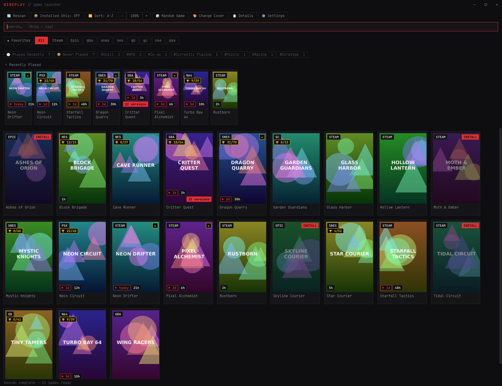
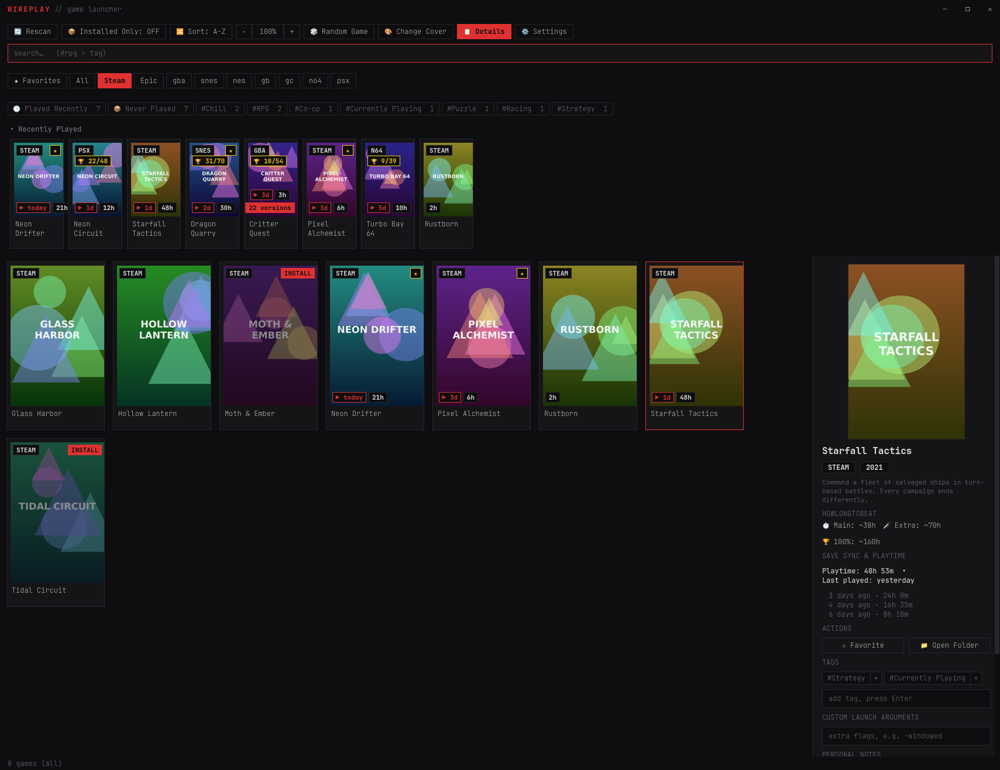
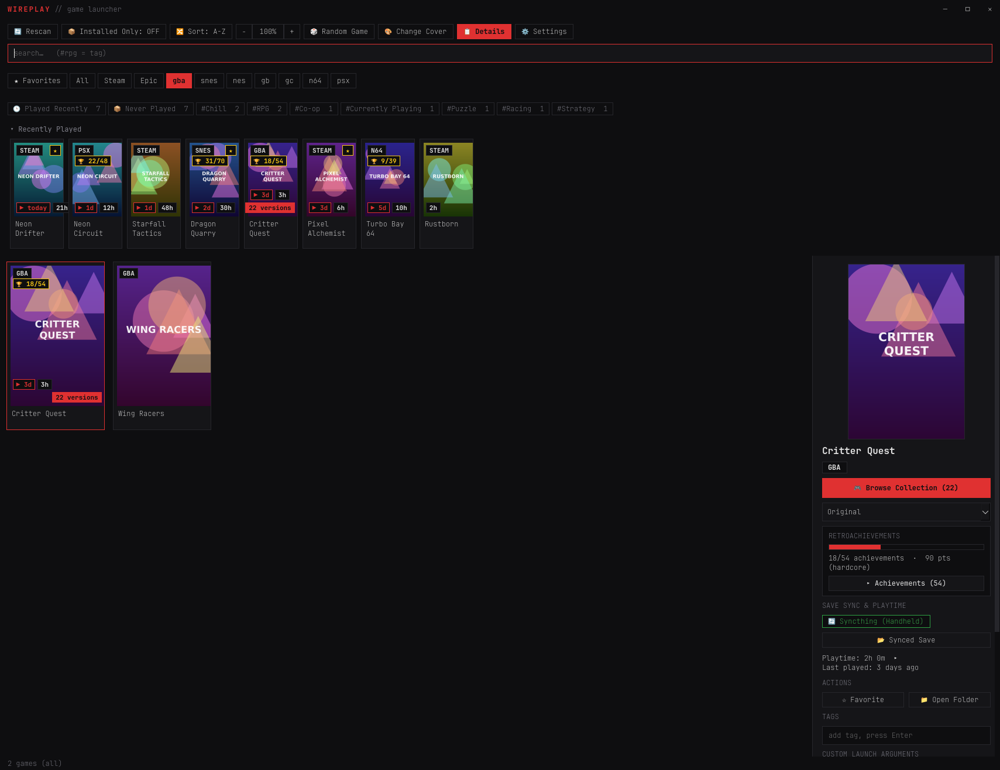
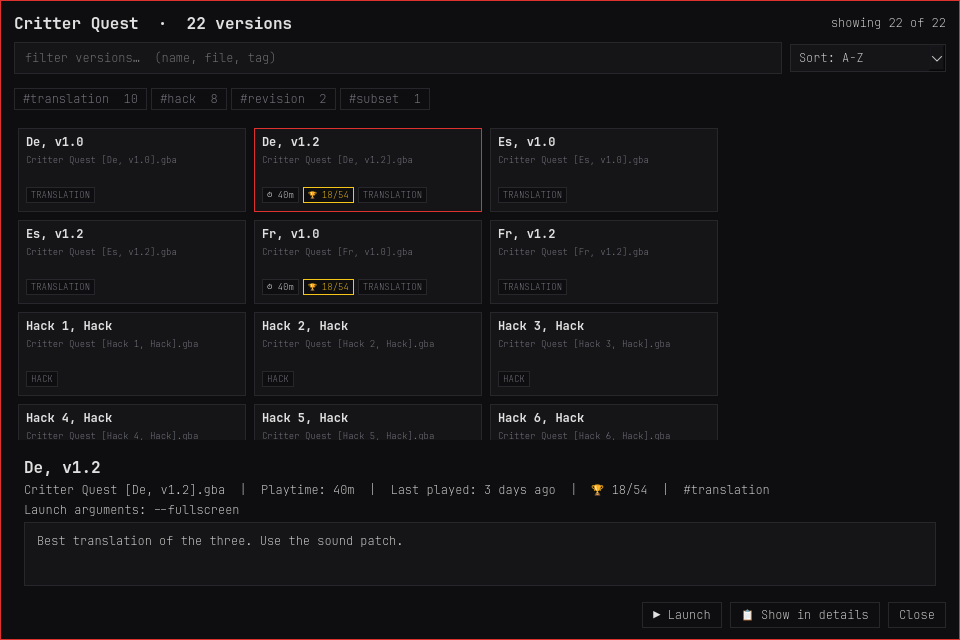
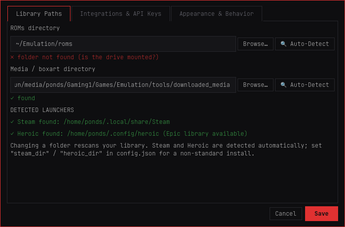
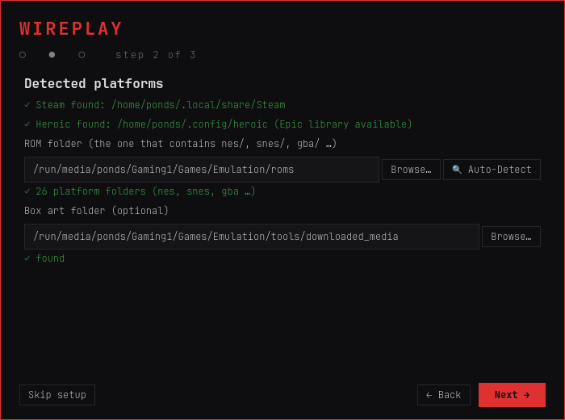

<p align="center">
  
</p>

<h1 align="center">WIREPLAY <sub>// game launcher</sub></h1>

<p align="center">
  One fast, dark, keyboard-friendly launcher for your Steam library, Epic games (through Heroic),
  Minecraft instances and your retro ROM collection.<br>
  Vertical posters, playtime, achievements and save-sync status, all in one grid.
</p>

---

## Screenshots

*Rendered from a fictional demo library (made-up games, generated covers) by [`tools/screenshots.py`](tools/screenshots.py).*



| Details drawer | A retro game with trophies and a synced save |
|---|---|
|  |  |

| Collection browser | Settings | First-run wizard |
|---|---|---|
|  |  |  |

## Highlights

- **One library, every source.** Steam (installed and owned games, plus non-Steam shortcuts), Epic through
  [Heroic](https://heroicgameslauncher.com/), Minecraft instances ([GDLauncher](https://gdlauncher.com/) Carbon) and ROMs
  in an EmuDeck / ES-DE style folder. Tabs per platform, a Favorites tab, sort by A-Z / recently played / playtime.
- **SteamGridDB vertical posters.** Proper 2:3 box art for PC games (free API key), Steam and Epic CDN art as
  fallbacks, libretro thumbnails for retro games, your own covers when you pick one. Everything is cached on disk,
  including a small thumbnail cache, so a 6,000-game library scrolls smoothly.
- **RetroAchievements sync.** `🏆 X/Y` badges on cards (gold `🥇 Mastered` at 100%), a progress bar with hardcore
  points and the full achievement list with badge icons in the details drawer. ROMs are matched by title and then
  confirmed by their **RetroAchievements hash** (computed on demand, never a bulk scan), so a translation or a mis-filed
  ROM does not show trophies it cannot earn.
- **HowLongToBeat stats.** `⏱️ Main`, `🗡️ Extra`, `🏆 100%` times plus a two-sentence synopsis and release year, fetched
  on demand and cached for good.
- **Syncthing awareness.** If a game's save file lives inside a folder shared by [Syncthing](https://syncthing.net/),
  the drawer shows `🔄 Syncthing (<other device>)` and a button that opens the synced save folder (handy for keeping a
  handheld and a PC in step).
- **Discord Rich Presence.** Shows the game you launched and for how long; clears when it exits. Talks to Discord over its
  local socket, no extra libraries. One switch in Settings turns it off.
- **Proton / Steam hand-off.** Steam games are launched through Steam, so Proton prefixes, compatibility tools and launch
  options stay Steam's own. wireplay then follows the *real* game process (not the launcher that exits at once) to
  record accurate playtime and sessions.
- **More:** tags (`#rpg` in the search box), a collection browser for big stacks such as 91 Pokémon ROM hacks, a
  *Recently Played* shelf with one-click resume, `Played Recently` / `Never Played` quick filters, per-game notes and launch
  arguments, session history, offline box art, card zoom, and a curses terminal UI.

## Requirements

- Linux (it reads `/proc` and uses `xdg-open`). Developed and tested on CachyOS with Wayland (niri), **Python 3.14** and
  **PySide6 6.11**; the syntax is checked to parse on Python 3.8+, so **Python 3.10+** is the stated minimum, but only 3.14 has
  actually been run (other Python versions and distributions are untested).
- **PySide6** for the GUI. The terminal UI and the scanners use only the standard library.
- Optional: `chafa` (covers in the terminal UI), Steam, Heroic, GDLauncher Carbon, EmuDeck / RetroArch (Flatpak), Syncthing,
  Discord.

## Install

```bash
git clone <your-fork-or-this-repo-url> wireplay
cd wireplay

# a) with pip, in a virtual environment
python3 -m venv .venv && . .venv/bin/activate
pip install -r requirements.txt

# b) or from your distribution, e.g. Arch / CachyOS
sudo pacman -S pyside6
```

Run it:

```bash
python3 gui.py                  # the graphical launcher
python3 app.py                  # the terminal launcher (Tab or [ ] switch platform, type to filter, Enter launches)
python3 app.py --scan           # rescan and print counts, no UI
python3 app.py --list           # print installed games, no UI
python3 gui.py --version        # the version (once installed: wireplay --version)
python3 gui.py --tab snes       # start on a tab        (also: --filter "text")
python3 gui.py --first-run      # show the setup wizard again
```

On the first start a short **setup wizard** looks for Steam, Heroic and your ROM folder, and lets you add the optional
API keys. Everything it asks for can be changed later in **⚙️ Settings** (`Ctrl+,`).

### Make it a real app (menu entry + `wireplay` command)

```bash
./install.sh              # app-menu entry, icon and a `wireplay` command, all inside your home directory
./install.sh --uninstall  # removes exactly those three files
```

After that, open your application launcher and type *Wireplay*, or run `wireplay` in a terminal. It needs no root access and
uses the virtual environment in `.venv/` if there is one. wireplay keeps running from the cloned folder (its library database
lives there), so keep the folder where it is. Run `./install.sh` again if you move it.

## Configuration

Settings live in `~/.config/wireplay/config.json` (created by the wizard; see [`config.json.example`](config.json.example)).
Use ⚙️ Settings or edit the file; blank means *auto-detect* or *off*.

| Key | Meaning |
|---|---|
| `roms_dir` | The folder that contains `nes/`, `snes/`, `gba/` ... Auto-detected under `/run/media`, `/media`, `/mnt`, `~/Emulation`, `~/Games`. |
| `media_dir` | Box art folder, `<platform>/covers/<rom name>.png` (EmuDeck: `tools/downloaded_media`). Auto-detected next to `roms_dir`. |
| `steam_dir`, `heroic_dir` | Only for non-standard installs. Native, `~/.steam` and Flatpak locations are detected. |
| `steamgriddb_api_key` | Free key from [steamgriddb.com/api](https://www.steamgriddb.com/api). Enables vertical posters. |
| `ra_username`, `ra_api_key` | RetroAchievements account and Web API key ([control panel](https://retroachievements.org/controlpanel.php)). Both set = on. |
| `shortcut_overrides` | Optional list for non-Steam shortcuts: `[{"match": "regex", "command": "/path/script.sh", "exclude": "regex"}]`. A shortcut whose title matches `match` is started with `command` instead of through Steam, or hidden if it also matches `exclude`. |
| `discord_rpc` | `true` / `false`. `discord_client_id` overrides the Discord application. |
| `card_width`, `startup_tab`, `shelf_collapsed` | Appearance: poster width 100-260, first tab (`all`, `favorites` or a platform), shelf state. |

A configured folder is used even when it is not there right now: if your ROM drive is unmounted, wireplay says so, keeps
your library and games list as they were, and keeps showing the box art it already copied to its local cache.

### How ROMs are launched

wireplay does not bundle emulators. For each ROM, in this order:

1. an [EmuDeck](https://www.emudeck.com/) launcher script `<roms_dir>/emulators/<emulator>.sh` for that platform
   (PCSX2, DuckStation, PPSSPP, RPCS3, Dolphin, Cemu, Ryujinx, melonDS, mGBA, xemu, Flycast ...);
2. the RetroArch (Flatpak) core for NES, SNES, N64, Genesis / Mega Drive, 32X and Atari 2600 when it is installed;
3. otherwise `xdg-open <rom>`.

## Keybindings

| Where | Key | Action |
|---|---|---|
| Grid | `Enter` | Launch (stacks with several versions open a picker, or the collection browser above 5 versions) |
| Grid | `Space` or `I` | Show / hide the details drawer |
| Grid | `F` | Favorite / unfavorite |
| Grid | right-click | Launch, favorite, details, change cover art, select / browse versions |
| Anywhere | `Ctrl` `+` / `=` | Bigger cards |
| Anywhere | `Ctrl` `-` | Smaller cards |
| Anywhere | `Ctrl` `0` | Reset card size |
| Anywhere | `Ctrl` + mouse wheel | Smooth card zoom |
| Anywhere | `Ctrl` `,` | Settings |
| Search box | `↓` | Move into the grid |
| Anywhere | `Esc` | Back one step: clear the search, then close the drawer, then quit |
| Search | `#tag` | Filter by tag (`#rpg`, `#currentlyplaying`), combinable with words |
| Recently Played shelf | double-click / `Enter` | Resume the game (the version you played last) |
| Terminal UI | `Tab`, `[` `]` | Switch platform |
| Terminal UI | type, `Ctrl-U`, `↑` `↓` `PgUp` `PgDn` `Home` `End`, `Enter`, `Esc` | Filter, clear, move, launch, clear/quit |

## What it talks to

wireplay makes network requests only for features you use, and never sends your library to anyone:

| Service | For | When |
|---|---|---|
| SteamGridDB | vertical posters | only with an API key |
| Steam and Epic CDNs, libretro thumbnails (GitHub) | fallback box art | when a poster is missing |
| RetroAchievements | progress, hash lists, badge icons | only with username + key |
| HowLongToBeat | times and synopsis | when you open a game's details. This uses the site's own web endpoints (it has no public API) and may stop working if they change; failures are silent and the section just stays hidden. |
| Discord | status | locally, through Discord's own socket on your machine |

API keys are stored in `config.json` (created with mode `600`) and are only ever sent to the service they belong to.

## Where things are stored

- Library database: `wireplay.db` next to the program (override with `WIREPLAY_DB=/path/to/db`).
- Settings: `~/.config/wireplay/config.json`.
- Caches: `~/.cache/wireplay/` (`covers`, `thumbs`, `ra`, `ra_badges`). All of it is rebuilt automatically and safe to remove.
- wireplay never writes to your ROM or art folders; art found there is copied to the local cache.

## Development

```bash
python3 tests/run_all.py          # ~530 checks, a minute or two; headless, no real data, no network
python3 tests/run_all.py config   # only the test files whose name contains "config"
python3 tools/screenshots.py      # re-render docs/screenshots from the fictional demo library
```

The tests run against a throw-away database, config and cache: `WIREPLAY_TEST=1` (set by `tests/support.py`) makes the
database and config code **refuse** the real `wireplay.db` and config and blocks all network access except localhost, so a
test can fail but cannot touch your library or your keys. The same variables are handy for experiments: `WIREPLAY_DB`,
`WIREPLAY_CONFIG` and `WIREPLAY_CACHE` point at other files, `WIREPLAY_ALLOW_NET=1` re-enables the network for a deliberate
live check.

Modules: `scanners.py` (Steam, Heroic, Minecraft, ROM scanners), `engine.py` (grouping, launching, sessions), `covers.py` (art),
`db.py` (SQLite), `metadata.py` (HowLongToBeat), `ra_client.py` (RetroAchievements), `discord_rpc.py`, `config.py`,
`gui.py` (PySide6), `app.py` (terminal UI). See [CONTRIBUTING.md](CONTRIBUTING.md).

## Status

**Version 0.16.0** (see the [changelog](CHANGELOG.md)). A personal project that I use daily, shared as is. Issues and pull requests are welcome, but there is no support
promise. It is Linux-only and has been run on one machine (see Requirements), so expect rough edges on other setups.

## Credits

[SteamGridDB](https://www.steamgriddb.com/), [RetroAchievements](https://retroachievements.org/),
[HowLongToBeat](https://howlongtobeat.com/), [libretro thumbnails](https://github.com/libretro-thumbnails),
[Heroic Games Launcher](https://heroicgameslauncher.com/), [EmuDeck](https://www.emudeck.com/), [Qt for Python](https://doc.qt.io/qtforpython-6/).
Not affiliated with any of them.

## License

[MIT](LICENSE)
